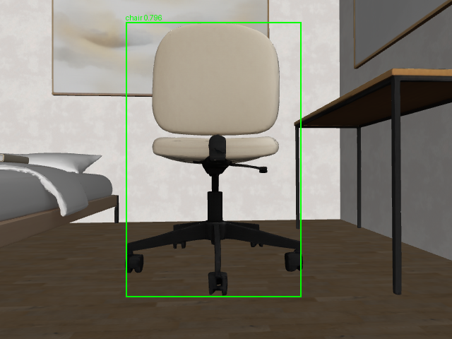
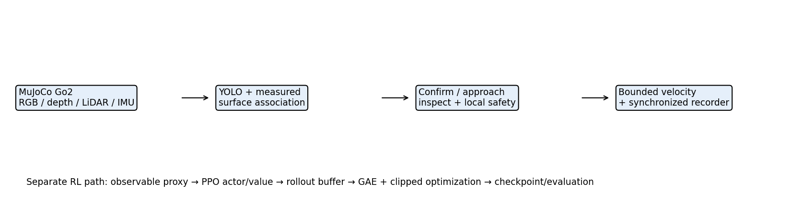

# Autonomous Indoor Object Search and Inspection Using the Unitree Go2

**Tyler's individual ENGR 6010 Second Test — November 10, 2026**  
Repository: https://github.com/CakeSlime/Unitree-Dog-Claude-Dog-
Submission branch: `tyler-second-test-standalone`; individual deliverable: `Test2_Tyler/`.

This submission connects actual pretrained YOLO chair inference to a physically simulated Go2 task, records synchronized dog-simulation data, and implements all required Gymnasium/PPO components. Shared infrastructure and Connor's original `Test2/` results are attributed and preserved. All dog recordings here are **simulated**, with no physical robot data claimed.

Start with the [final technical report](report/ENGR6010_Second_Test_Final_Report.md), [PDF](report/ENGR6010_Second_Test_Final_Report.pdf), [DOCX](report/ENGR6010_Second_Test_Final_Report.docx) and [requirement-by-requirement submission audit](report/Final_Submission_Audit.md).

## Results at a glance

| Question | Implemented and verified | Limits |
|---|---|---|
| Q1: Vision/ML dog task | Actual CPU YOLOv10n; fresh-frame confirmation, depth-supported approach, stopped inspection capture; two independently scored Phase 2C successes | Initially visible development targets; six exploration trials timed out; no detector accuracy benchmark |
| Q2: Dog data/simulation | Physical Go2 MuJoCo simulation; RGB, registered/legacy depth, LiDAR, IMU, pose, velocity, commands, task states; synchronized recordings, hashes, GIFs and plots | Simulation only; no hardware recordings; ideal registered simulated depth |
| Q3: RL components | Application Gymnasium environment, sensor observation, actions, rewards, actor/critic configuration, reset, episodes, PPO/GAE via SB3, callbacks, save/load and paired baseline evaluation | 2,048-step historical smoke and 8,192-step new run verify training operation; useful learning and MuJoCo transfer not demonstrated |

The final 8,192-step run completed in 24.74 wall seconds with finite losses/gradients, changed weights, 16 periodic checkpoints and successful model reload. Evaluation on eight new episodes per policy gave PPO **0/8 successes**, random **0/8**, and the memory-based scan-vantage controller **4/8**. These are detector-proxy results, separate from actual YOLO/MuJoCo demonstrations. The professor's allowance for incomplete training is addressed through complete executable RL components and honest recorded outcomes.



## Background and architecture

Indoor inspection motivates a dog that finds an object from camera evidence, approaches a repeatable standoff and records an image. A chair is the individual application target. YOLO is an allowed alternative ML method; no newly trained detector is claimed.



RGB → YOLO box → supported depth component → search/confirm/approach/inspect → local safety → bounded forward/yaw command → physical simulated Go2. A separate recorder stores observations and decisions. Hidden target coordinates and evaluation-only semantic mesh rays do not drive navigation or policy observations.

The shared scripted physical trot supplies locomotion; this project does not train Go2 joint-level control. Inspection is horizontal camera-to-measured-visible-surface distance 0.95±0.10 m, with at least 0.025 m engineering margin, bearing ≤0.10 rad, speed <0.06 m/s and three fresh stable hold frames. Clipped boxes may center the camera but cannot justify range-based motion or completion. Missing valid target evidence stops approach.

## Evidence to review

- **Calibrated actual-simulation success:** [summary](data/phase2c/calibration_visible_002/summary.json), [GIF](data/phase2c/calibration_visible_002/demo.gif), [inspection](data/phase2c/calibration_visible_002/inspection/observation.json), [YOLO/checksum/timestamp verification](report/phase2c/verified_trials_001/calibration_visible_002.json). 42 frames, 8.2 simulated seconds, 0.885 m path, no contact steps; reference chair-surface range 1.022117 m.
- **Exploration failure retained:** [summary](data/phase2c/explore_context_002/summary.json), [GIF](data/phase2c/explore_context_002/demo.gif). 4.162 m path, target discovery/confirmation and two recoveries, then timeout at 65 s.
- **Absent-target control:** [summary](data/phase2c/absent_001/summary.json), [verification](report/phase2c/verified_trials_001/absent_001.json).
- **Original individual pilot:** [Phase 2A summary](data/sample/demo_001/summary.json), [GIF](data/sample/demo_001/demo.gif), [replay](report/demo_001_replay.json). Historical uncalibrated depth interpretation is explained in the final report.
- **RL training:** [new summary](results/phase2c/ppo_submission_20261110/smoke_summary.json), [curves](results/phase2c/ppo_submission_20261110/smoke_learning_curves.png), [final model](results/phase2c/ppo_submission_20261110/final_model.zip), [checkpoints](results/phase2c/ppo_submission_20261110/checkpoints/).
- **RL comparison:** [metrics](results/phase2c/ppo_submission_eval_20261110/metrics.json), [all 24 episodes](results/phase2c/ppo_submission_eval_20261110/episodes.csv), [figure](report/final_figures/ppo_evaluation.png).
- **Tests:** [50 passing tests](report/submission_tests.xml). [Historical development integrity audit](report/submission_integrity.json) records the original full-workspace checks; it does not certify the reduced standalone checkout. See [current publication link audit](report/publication_link_audit.json).

## Setup and data restoration

Run from the **standalone repository root**. This checkout does not bundle `Phase_2_Investigator/`, `go2_stream/`, the simulator or a virtual environment. Follow [pinned shared-module and Python setup](PUBLICATION_SETUP.md) first. Installing pip packages alone is insufficient. No ROS or physical SDK is needed.

```bash
# First obtain the shared modules using PUBLICATION_SETUP.md; this standalone repository has no submodules.
export MUJOCO_GL=egl OMP_NUM_THREADS=1 OPENBLAS_NUM_THREADS=1
export MPLCONFIGDIR=/tmp/tyler-matplotlib
# Only when dependencies are missing; do not replace an existing working environment:
uv pip install --python .venv/bin/python --only-binary :all: -r Test2_Tyler/requirements.txt
# CPU Torch is required for RL; see requirements-rl.txt before optional installation.
uv pip install --python .venv/bin/python -r Test2_Tyler/requirements-rl.txt
uv pip check --python .venv/bin/python
# Raw streams are archived losslessly to reduce active Git file count:
.venv/bin/python -B Test2_Tyler/package_recordings.py restore
# Explicit checksum-pinned pretrained ONNX weights download:
.venv/bin/python -B -m Test2_Tyler.assets
```

The simulator revision used was `d6e54647541fb7b048db5d9817457ee11d0e2cf9`. Full environment: [freeze](report/phase2c/environment.freeze.txt). YOLO source: [THU-MIG](https://github.com/THU-MIG/yolov10), [ONNX Community export](https://huggingface.co/onnx-community/yolov10n). The distributor identifies AGPL-3.0. URL/hash/preprocessing are in [adapters/yolo.py](adapters/yolo.py). Downloaded weights are reproducibly obtained from source and excluded as cache; all individual PPO weights are included.

Original sensor recordings remain intact in the development checkout. The 2.57 GiB archive parts are local but excluded from this published Git branch; uploading the dataset is still pending. See the [Release upload/download plan](RECORDINGS_RELEASE.md). [Archive manifest](recording_archives/manifest.json) enumerates complete raw streams, split into ≤40 MiB files with SHA-256. The publication correction restores missing Phase 2B/2C summaries, state/event tables, metadata, source snapshots, inspections, plots and GIFs as small browsable files. They must be committed with this correction; they are distinct from the raw stream archives. After downloading every manifest-listed Release asset into `recording_archives/`, restore verifies hashes and refuses conflicting existing files. `package_recordings.py verify` checks archives without creating missing raw files. Some interrupted historical recordings intentionally have no finalized summary; these are not counted as successful trials.

## Bounded reproduction

Use fresh output names. Do not run simulators concurrently. Expected task failures exit 2 and their evidence must be retained.

```bash
timeout 60s .venv/bin/python -B -m pytest -q Test2_Tyler/tests
# Recheck recorded actual YOLO results, without restarting MuJoCo:
timeout 120s .venv/bin/python -B -m Test2_Tyler.phase2c.verify \
  --trial Test2_Tyler/data/phase2c/calibration_visible_002 --repeat-yolo \
  --out Test2_Tyler/report/phase2c/calibration_recheck_NEW.json
# Reproduce independent bounded PPO run and same-task baseline comparison:
timeout 110s .venv/bin/python -B -m Test2_Tyler.q3_rl.train_phase2c \
  --steps 8192 --seed 601110 --out Test2_Tyler/results/phase2c/ppo_reproduction_NEW
timeout 110s .venv/bin/python -B -m Test2_Tyler.q3_rl.evaluate_phase2c \
  --model Test2_Tyler/results/phase2c/ppo_reproduction_NEW/final_model.zip \
  --out Test2_Tyler/results/phase2c/eval_reproduction_NEW --episodes 8 --seed 811110
```

Fresh actual MuJoCo trials: [Phase 2C commands](phase2c/README.md). The preserved original Phase 2A successful pipeline can be reproduced with the probe/run/replay commands in [historical README](README_Phase2A_2B.md). New exploration configs may fail as documented; they must not replace the existing success evidence.

## Code and RL responsibilities

| Area | Application code |
|---|---|
| Q1 | `adapters/yolo.py`, `q1_vision/`, `phase2c/perception.py`, `control.py`, `approach.py` |
| Q2 | `adapters/shared.py`, `phase2c/simulation.py`, `run.py`, `verify.py`, `q2_data_simulation/` |
| Q3 task | `q3_rl/object_search_env.py`, `feasible_env.py`, `observations.py` |
| Q3 training/evaluation | `q3_rl/train_phase2c.py`, `evaluate_phase2c.py`, `search_baseline.py` |
| Verification | `tests/`, `report/phase2c/verified_trials_001/`, `submission_tools/` |

The application supplies the environment, 38-value observable vector, two bounded actions, reward, seeded reset, success/collision termination, timeout truncation, network configuration, budget, callbacks and evaluation. SB3 supplies actor/value MLPs, Gaussian sampling, rollout collection/storage, GAE and clipped PPO optimization. [The final report's 12-component matrix](report/ENGR6010_Second_Test_Final_Report.md#52-requirement-to-code-matrix) maps every professor requirement to code and evidence. There is no claim of custom PPO internals.

## Attribution and submission

[CONTRIBUTIONS.md](CONTRIBUTIONS.md) and [Phase 2C attribution](phase2c/CONTRIBUTIONS.md) distinguish shared infrastructure, third-party frameworks, adapted algorithms and new individual experiments developed with coding-agent assistance. No original `Test2/` files are modified or presented as newly trained individual evidence.

The individual code/report submission is published at [tyler-second-test-standalone](https://github.com/CakeSlime/Unitree-Dog-Claude-Dog-/tree/tyler-second-test-standalone/Test2_Tyler). This publication correction has not been committed or pushed by the agent; raw archive Release upload and Canvas submission remain unconfirmed. See the [publication audit](report/Final_Submission_Audit.md), [dependency setup](PUBLICATION_SETUP.md) and [dataset delivery plan](RECORDINGS_RELEASE.md). Hardware data, robust unknown-target inspection, useful learned PPO performance and actual policy transfer remain absent; they are explicitly disclosed in the report.
