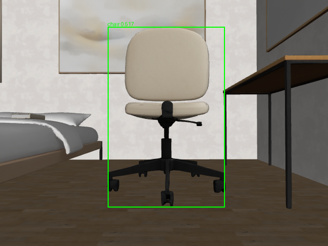
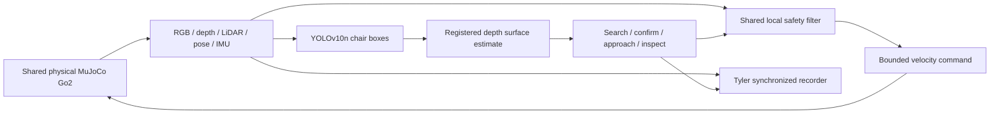

# Autonomous Indoor Object Search and Inspection Using the Unitree Go2

Tyler's individual ENGR 6010 Second Test application. Phase 2A implements a simulated **YOLO chair search → confirmation → approach → inspection image** pipeline and synchronized sensor recording. Phase 2B adds sensor-map exploration and a separate Gymnasium/PPO foundation. It reuses attributed project infrastructure and preserves Connor's `Test2/` work.

**Actual Phase 2A pilot result:** 69 frames over 13.6 simulated seconds; inspection saved at an estimated camera-to-chair surface range of 1.049 m; no recorded robot-scene contacts. Repeating YOLO inference on every recorded frame reproduced the detections and task decisions. This is a single configured scene, not a general success-rate study. Phase 2B now has a verified 2,048-step PPO smoke checkpoint in a detector-proxy environment; useful learned navigation and physical deployment are not demonstrated. See the [Phase 2B report](report/Phase2B_Implementation_Report.md) for current results and limitations. The pilot descriptions below refer to the preserved Phase 2A runner.



## Setup

Use the existing repository Python 3.12 environment. Run commands **from the repository root**, not from this folder:

```bash
source .env.phase1  # existing local settings, if available; source only from repository root
export UV_CACHE_DIR="$PWD/.cache/uv"
export MUJOCO_GL=egl
export OMP_NUM_THREADS=1 OPENBLAS_NUM_THREADS=1
# Only if packages are missing; do not recreate an already working .venv:
uv pip install --python .venv/bin/python --only-binary :all: -r Test2_Tyler/requirements.txt
uv pip check --python .venv/bin/python
# Explicit, checksum-verified external weights download (9.39 MB):
.venv/bin/python -m Test2_Tyler.assets
```

The pinned simulator submodule must already exist at `Phase_2_Investigator/third_party/robot-unitree-go2-mujoco`. Its inspected revision is `d6e54647541fb7b048db5d9817457ee11d0e2cf9`; no extra simulator checkout, DDS, or physical SDK is needed. The validated environment snapshot is [report/environment.freeze.txt](report/environment.freeze.txt).

The model is [ONNX Community's YOLOv10n export](https://huggingface.co/onnx-community/yolov10n), from [THU-MIG YOLOv10](https://github.com/THU-MIG/yolov10), identified as AGPL-3.0 by its distributor. SHA-256 is pinned in `adapters/yolo.py`; weights remain in ignored `.cache/models/`. The [published processor](https://huggingface.co/onnx-community/yolov10n/blob/main/preprocessor_config.json) uses longest-edge resize, RGB scaling, and padding; our adapter uses bottom/right zero padding and reverses the resize scale for boxes. It shares the group's `Detection` type but runs CPU ONNX inference, not the existing Ultralytics/PyTorch backend. No YOLO weights were trained by Tyler in this stage.

If sandbox DNS blocks downloads, use the normal network-authorized environment. Project-local cache paths solve the earlier cache restriction; do not remount filesystems or bypass a real filesystem fault. Stop on EROFS/EIO. An ONNX Runtime GPU-discovery warning about `/sys/class/drm/...` occurred here; inference explicitly uses `CPUExecutionProvider` and completed successfully.

## Reproduce in bounded stages

Every experiment output directory must be **new**. Existing output directories are refused. The names below intentionally differ from committed evidence. Do not run several simulators concurrently.

```bash
# Lightweight task/data/geometry tests; no MuJoCo session or weights download:
timeout 60s .venv/bin/python -m pytest -q Test2_Tyler/tests

# 1. Stationary, aligned camera gate: requires actual chair confidence >= 0.30.
timeout 90s .venv/bin/python -u -m Test2_Tyler.probe \
  --yaw 1.57 --out Test2_Tyler/results/probe_reproduction_001

# 2. Search starts facing away from the chair; control sees only detector/sensor data.
timeout 120s .venv/bin/python -u -m Test2_Tyler.run \
  --gate Test2_Tyler/results/probe_reproduction_001/gate.json \
  --out Test2_Tyler/data/sample/demo_reproduction_001 --wall-limit 90

# 3. Verify stored files/timestamps, recompute depth targets/task decisions, repeat YOLO.
timeout 60s .venv/bin/python -m Test2_Tyler.q2_data_simulation.replay \
  --trial Test2_Tyler/data/sample/demo_reproduction_001 --repeat-yolo \
  --out Test2_Tyler/report/replay_reproduction_001.json
```

The mission additionally has a 35-second **simulation-time** limit. It exits 0 on inspection completion and 2 on an expected task failure. A deliberate one-second search timeout uses `--config Test2_Tyler/config/chair_timeout.yaml` with the same gate and a fresh trial directory. It should finish as `failed/task_timeout` with zero final command, not as a successful inspection.

The gate is performed before navigation and checks actual detection, model checksum, scene/camera/target-placement settings, and confidence. Its aligned probe spawn differs from the mission's initial heading. The mission does not read the probe's box, target location or pose; it reads fresh YOLO detections during search. Gate results are pilot configuration checks, not independent detector accuracy evaluation.

## Method and safety behavior



- **Scene:** furnished house 185, shared textured chair mesh, with Tyler's placement and lights applied only to a generated temporary scene. The base starts at `[4.88,1.1,0]`. The target pose is scene configuration, not a control observation. Search is an in-place camera scan in one open region; global exploration is future work.
- **Camera:** same Go2 front-camera mount/FOV, configured to 640×480 RGB. Depth is still raycast at 160×120 and upsampled. This is a configured simulator sensor, not evidence of hardware RGB-D capability.
- **Confirmation:** three consecutive fresh detections, confidence ≥0.30, valid registered depth, and a 0.65 m continuity gate around the first observed world-surface estimate. Tiny/edge-clipped boxes are rejected. Ground-truth detections are rejected by the observation adapter.
- **Approach:** turn before moving; forward ≤0.18 m/s, yaw ≤0.35 rad/s; no reverse, strafe, or blind finish. Target range is the camera-to-observed-surface horizontal distance from central box depth, not object-centre ground truth.
- **Inspection:** estimated range within 0.95±0.10 m, bearing within 0.10 rad, measured horizontal speed <0.06 m/s, three valid hold frames. Save RGB, annotated image, estimate, pose and frame/time reference, then stop.
- **Independent guard:** shared `navigation.local.SafetyLayer` filters requested commands using measured LiDAR and depth obstacle points. Contacts, excessive tilt, stale/repeated/future frames, missing target, sustained blockage, task timeout and wall-clock budget stop the task. These mechanisms are not a general safety guarantee or physical validation.

## Project structure and evidence

| Area | Files / evidence |
|---|---|
| Shared adapters | `adapters/shared.py`, `adapters/yolo.py`; no imports from Connor's `Test2` |
| Q1 individual application | `q1_vision/observations.py`, `q1_vision/mission.py`, `probe.py`, `run.py` |
| Q2 data | `q2_data_simulation/recording.py`, `replay.py`; [sample format](data/README.md) |
| Actual success recording | [summary](data/sample/demo_001/summary.json), [GIF](data/sample/demo_001/demo.gif), [trajectory](data/sample/demo_001/trajectory.png), [inspection observation](data/sample/demo_001/inspection/observation.json) |
| Failed first detector gate | `results/probe_001/`; retained, not overwritten or relabeled |
| Passed detector gate | [probe_002](results/probe_002/gate.json), [rendered detection](results/probe_002/detections.png) |
| Tests and replay | Latest: **16 tests passed**, `report/tests-deadline.xml` / `.log`; [demo replay verification](report/demo_001_replay.json) |
| Attribution | [CONTRIBUTIONS.md](CONTRIBUTIONS.md) |
| Technical report | [Phase2A implementation report](report/Phase2A_Implementation_Report.md) |
| Q3 environment and smoke pipeline | [q3_rl/README.md](q3_rl/README.md); separate detector-proxy environment and Tyler smoke checkpoint |

## Phase 2A limits and original next steps

This pilot establishes actual detector-conditioned simulated movement and reproducible recording, not robust indoor autonomy. The chair placement, lighting, resolution and start were selected during development. There is one successful trial, no held-out detection precision/recall study, no second object class, no calibrated range-error study, and no whole-building exploration. The first unmodified-scene 320×240 detector probe failed. The successful probe changed preprocessing, resolution and placement; it is not an ablation showing which change caused improvement.

The first deliberate timeout (`timeout_001`) exposed a floating-point comparison that delayed stopping by one tick. It is retained. The corrected deadline-tolerance configuration stopped `timeout_002` at 1.0 simulated second with a zero command, and its recording replay passed. Legacy trial configs retain their old comparison behavior for accurate historical replay.

Use Tyler-owned held-out placements/start poses/distractors and a classical exploration baseline next. Then define and train Tyler's PPO task with robot-observable inputs, identical termination/scoring for all methods, validation-based model selection and new evaluation evidence. Connor's policies/results remain prior work. Resolve the professor's physical-dog requirement before claiming all Second Test questions complete; this stage is simulation-only.

## Phase 2B current execution and evidence

The [Phase 2B implementation report](report/Phase2B_Implementation_Report.md) supersedes the historical next steps above. Current validation: **33 tests passed**; a fresh 2,048-step PPO smoke run changed weights and reloaded successfully. Eight independent proxy evaluations per method produced **zero successes** for PPO, reactive classical and random policies. Useful learned search is not demonstrated. See [Q3 methods and commands](q3_rl/README.md).

Optional RL dependencies are pinned in `requirements-rl.txt`. Reuse the installed CPU Torch and existing `.venv`; if the optional libraries are absent, install only that small batch using the local uv cache. Do not start extended training as part of setup.

Actual-YOLO exploration uses `search.py`, `q1_vision/exploration.py` and the attributed dependency-light `sensor_map.py`. Target loss stops immediately, then recovers to exploration; reachable goals remain committed. Phase 2B inspection allows three valid observations within one second, with current-frame detection, identity/range/bearing/stability checks. Depth comes from the upper portion of the YOLO box, still a heuristic vulnerable to foreground/collision geometry.

```bash
source .env.phase1
timeout 120s .venv/bin/python -B -m Test2_Tyler.search \
  --config Test2_Tyler/config/phase2b/near_heading.yaml \
  --out Test2_Tyler/data/phase2b/near_reproduction_001 --wall-limit 90
timeout 90s .venv/bin/python -B -m Test2_Tyler.q2_data_simulation.verify_search \
  --trial Test2_Tyler/data/phase2b/near_reproduction_001 --repeat-yolo \
  --out Test2_Tyler/report/phase2b/near_reproduction_001_verify.json
```

`visible_control`, `near_heading`, `occluded_start`, `shifted_target` and `absent_target` configs are under `config/phase2b/`. An expected failed task exits 2, and its recording remains valuable evidence. Always choose new outputs. Four new actual trials produced two controller-defined inspections and two failures, all without recorded contacts; every-frame reinference matched. The two completions did not require forward exploration, and their independent visual-mesh ranges were outside the intended standoff band. Depth calibration and successful translational exploration remain the next priorities. Phase 2A data and all unsuccessful/interrupted Phase 2B evidence remain intact.
