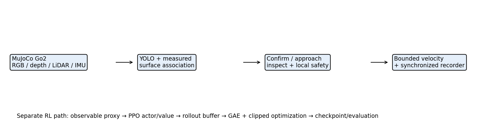
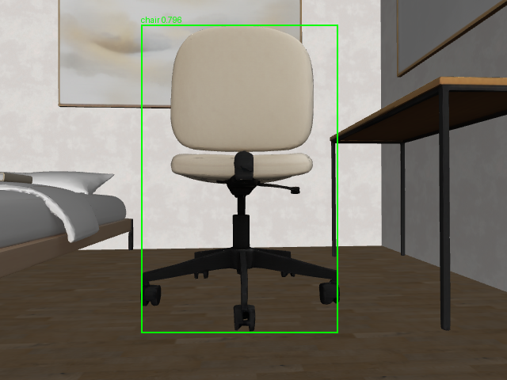
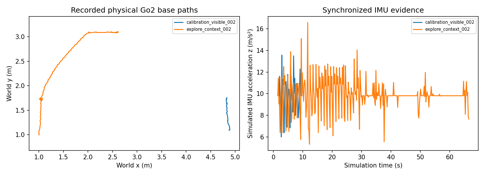
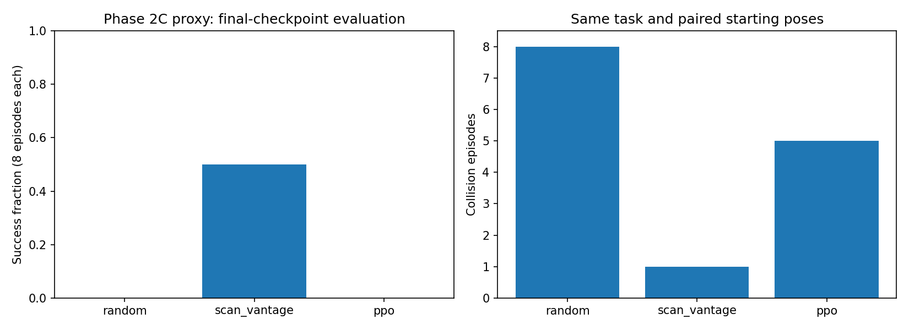

# ENGR 6010 — Second Test: Individual Final Technical Report

**Autonomous Indoor Object Search and Inspection Using the Unitree Go2**  
**Student:** Tyler (individual submission)  
**Date:** November 10, 2026  
**Repository:** https://github.com/CakeSlime/Unitree-Dog-Claude-Dog-
**Submission branch:** `tyler-second-test-standalone`
**Individual workspace:** `Test2_Tyler/`

**Publication:** Code/report published on the standalone branch; raw archive assets remain pending. Publication corrections do not alter experimental outcomes.

## Abstract

This project integrates pretrained YOLOv10n chair recognition with a physically simulated Unitree Go2, bounded visual approach, inspection capture and synchronized sensor recording. It also implements a distinct Gymnasium reinforcement-learning task and a complete Stable-Baselines3 PPO training/evaluation pipeline. Two Phase 2C development trials completed calibrated inspection with independent chair-surface checks. Six exploration trials and an absent-target trial timed out; they are retained. An additional 8,192-transition CPU PPO experiment verified optimization and model persistence but achieved zero successes in eight new evaluation episodes. The work demonstrates implemented vision, simulation/data and RL components, without claiming converged learning, general indoor autonomy or physical robot data.

## 1. Background and motivation

A mobile dog robot can inspect indoor objects from a repeatable viewpoint while keeping people away from hazardous or inaccessible areas. A chair is an observable, common indoor target for a course-scale demonstration. The task is to find a chair from the robot camera, confirm that it persists across fresh frames, approach a measured visible surface, stop at a specified distance and save an inspection image. Detection alone is insufficient: the controller must connect image evidence to motion, prevent blind approach and record enough information to explain failures.

The Second Test asks for vision/ML in a dog task (Q1), dog data and an actual dog simulation (Q2), and all RL components even when time or compute prevents complete training (Q3). This submission is explicitly simulation-only. The quoted instructions do not establish that hardware recordings can be claimed from simulation. If the professor expects physical dog recordings in addition to the stated simulation work, that part remains absent.

## 2. Application and system architecture



The preserved shared simulator provides the Go2 model, contacts, scripted torque-driven trot, camera, LiDAR and IMU. Tyler's adapters configure the scene through temporary files; shared sources and Connor's original `Test2/` experiments are preserved. High-level commands are limited to 0.18 m/s forward and 0.35 rad/s yaw, with local sensor-based safety filtering. The experiment's controller is classical perception-driven logic. PPO runs in a separate inexpensive 2-D detector proxy and is not deployed in the MuJoCo demonstrations.

The physical simulation and proxy are different experimental systems. MuJoCo includes joint/contact dynamics and actual neural inference on rendered images. The proxy approximates base velocity lag, obstacles, LiDAR, detection FOV, occlusion and dropout. Proxy success cannot establish actual YOLO or physical Go2 performance.

## 3. Q1 — Vision/ML methods and implementation

### 3.1 Method

YOLOv10n is pretrained object detection, an allowed alternative ML method. No new YOLO training is claimed. The ONNX CPU adapter resizes/pads rendered RGB, performs actual inference, maps boxes back to camera coordinates and filters the chair class by confidence and geometry. Model URL and SHA-256 are pinned in [the adapter](../adapters/yolo.py); [assets.py](../assets.py) downloads and verifies weights explicitly. Weights are reproducible external assets, rather than hidden task annotations.

Phase 2A used a bounding-box depth heuristic. Phase 2C discovered that legacy depth raycasts collision geometry while RGB renders visual meshes; a constant range correction is inappropriate. The versioned simulator produces registered rendered RGB-D using the same camera and visibility mask, preserving legacy depth separately. This is an ideal simulated sensor, not a validated physical depth camera.

[Depth association](../phase2c/perception.py) selects a supported near-depth component within the detected box. It rejects invalid/near depth, inconsistent support, partial boxes as range evidence and implausible temporal changes. A box is not a semantic mask: clutter can still break association. Horizontally clipped detections can rotate the camera toward a candidate, but cannot justify forward motion or inspection.

### 3.2 Dog task

The state machine searches, confirms a candidate on consecutive fresh observations, approaches under bounded commands, and captures inspection after stable evidence. Missing valid target evidence stops forward approach. Sensor-map frontier/coverage navigation and recovery use measured LiDAR/pose and observed surfaces. Unseen chair coordinates are not controller or policy inputs. Semantic mesh rays are queried after decisions for evaluation only.

Inspection distance is horizontal camera-optical-centre to the selected measured visible surface patch. The target is 0.95 ± 0.10 m, with an engineering margin of at least 0.025 m required inside that interval. Bearing must be within 0.10 rad, horizontal speed below 0.06 m/s, and three fresh consecutive valid hold frames must be obtained. The margin is not a statistically calibrated confidence interval. Completion is independently scored against a chair mesh ray and reference range.

### 3.3 Results

The preserved [Phase 2A demonstration](../data/sample/demo_001/summary.json) completed in 13.6 simulated seconds, recorded 69 frames and 1.010 m of base path, and reported no robot-scene contacts. Its estimated final range was 1.049 m. That historical estimate used the earlier depth method and should not be presented as calibrated independent surface accuracy. [Replay verification](demo_001_replay.json) reran YOLO and reproduced recorded detections and decisions.

Phase 2C `calibration_visible_002` completed in 8.2 s, with 42 frames and 0.885 m of path, zero recorded contact steps, a measured range of 1.022118 m and independent reference 1.022117 m. The reference ray hit the chair. The very small same-simulator range difference checks sensor registration, not real-world measurement accuracy. `calibration_visible_001` independently completed at reference 1.009272 m. Both began with a visible target and required approach, not successful unknown-target translational search.



Evidence: [calibrated trial summary](../data/phase2c/calibration_visible_002/summary.json), [actual-camera GIF](../data/phase2c/calibration_visible_002/demo.gif), [every-frame YOLO verification](phase2c/verified_trials_001/calibration_visible_002.json). These are development trials, not held-out detector precision/recall or generalization benchmarks.

## 4. Q2 — Dog data and physical simulation

### 4.1 Collection and provenance

The shared Unitree Go2 model runs in MuJoCo with actual contact dynamics and scripted low-level locomotion. Sensor acquisition occurs at a common physics state every 0.2 simulated seconds (5 Hz nominal recording). RGB is 640×480. The recorder saves float depth with camera intrinsics/extrinsics, LiDAR ranges/cloud/transforms, IMU gyro/acceleration, pose/quaternion, velocity, requested/applied commands, contacts, safety interventions, inference latency and task decisions. Phase 2C also retains collision-depth streams, depth-quality diagnostics, source snapshots and post-decision scoring. Joint telemetry is not part of this recorder's exported state table; no unrecorded motor measurements are claimed.

[Recording code](../q2_data_simulation/recording.py), [format description](../data/README.md) and per-trial metadata define units and frame links. Simulation time and wall time are distinct. Terminal commands are zero in verified completed trials. SHA-256 manifests protect recorded contents. Some Phase 2B interrupted folders lack a finalized summary; these remain explicitly unfinished evidence, not successful trials.

### 4.2 Actual Phase 2C results

| Development trial | Frames | Sim time (s) | Path (m) | Evaluated success | Contact steps |
|---|---:|---:|---:|---|---:|
| absent_001 | 51 | 10.0 | 1.046 | no | 0 |
| calibration_visible_001 | 59 | 11.6 | 0.959 | yes | 0 |
| calibration_visible_002 | 42 | 8.2 | 0.885 | yes | 0 |
| explore_context_001 | 326 | 65.0 | 7.890 | no | 0 |
| explore_context_002 | 326 | 65.0 | 4.162 | no | 0 |
| explore_room_001 | 326 | 65.0 | 9.296 | no | 0 |
| forward_search_001 | 276 | 55.0 | 6.734 | no | 0 |
| reachable_search_001 | 276 | 55.0 | 5.389 | no | 0 |
| reachable_search_002 | 276 | 55.0 | 5.206 | no | 0 |

These nine trials contain 1958 recorded frames. Two initially visible controls completed; all six target-present exploration trials timed out, and the absent-target control timed out as intended. All nine summaries report zero contact steps. This count describes the development set and is not an estimate of performance over a randomized test population.



`explore_context_002` moved 4.162 m, detected at 23.2 s, confirmed at 23.6 s and recovered twice after target loss, but did not inspect before 65 s. It demonstrates sensor-conditioned exploration and recovery with an unresolved approach/search integration limitation. No further exploration tuning was needed for submission completion.

### 4.3 Data delivery and reproducibility

Raw sensor folders are preserved losslessly in locally prepared archives described by [recording archive parts](../recording_archives/manifest.json), each at most 40 MiB. Archive parts are not included in this standalone Git branch; Release asset publication remains pending. See [dataset delivery](../RECORDINGS_RELEASE.md) and [shared dependency setup](../PUBLICATION_SETUP.md). Originals remain intact in the development checkout. Summaries, metadata, event/state tables, inspection images, plots, GIFs and verification records remain directly browsable. Download all manifest-listed Release parts before running `package_recordings.py restore` after cloning to reconstruct raw files at their original paths; existing differing files cause a refusal, not overwrite. The archive manifest includes every part's length and SHA-256. This packaging preserves data while reducing Git's active file count. It does not fabricate, subsample or delete recordings.

## 5. Q3 — RL formulation and complete PPO components

### 5.1 Task definition

[ObjectSearchEnv](../q3_rl/object_search_env.py) implements Gymnasium reset/step/render; [FeasibleSearchEnv](../q3_rl/feasible_env.py) versions it for camera-surface range and a 1,200-step (240 s) exploration budget. Seeded reset samples free spawn, target, yaw and divider position in an 8×6 m proxy room. Internal target geometry supports simulated sensing and scoring; it is absent from observations and info when unseen. This is partially observable navigation, not an oracle-goal task.

The observation is 38 finite float32 numbers in [-1,1]: 24 normalized LiDAR samples, five current detection features (visibility, confidence, bearing, range and reserved age), three body-velocity features, two previous-command features, and four local visited-cell flags. Unseen detection features are zero. Local visited flags use map-axis offsets, not a full egocentric occupancy map. The policy is feedforward; the scan-vantage baseline has memory, a relevant comparison limitation.

Actions are a two-value Box in [-1,1]. Physical proxy commands are `vx=0.18*max(0,a[0])` and `yaw_rate=0.35*a[1]`, with no reverse or lateral velocity. Four substeps per 0.2 s interval and 0.15 s first-order lag approximate motion. Collision is checked against an inflated base footprint.

Reward is +0.25 for a newly visited 0.25 m cell, +1 for first detection, +3 for first confirmation, clipped consecutive-visible range progress (±0.2), +15 for inspection, −5 for collision, −0.02 each step and −0.015 times squared action change. No unseen target direction/progress reward is supplied. This exploration reward measures visited base cells, not verified camera coverage.

Success and collision terminate an episode; exhaustion of 1,200 steps truncates. The new proxy uses a 0.32 m camera offset and an effective ±0.075 m band within the nominal ±0.10 m inspection tolerance. Three confirmation and inspection frames, low speed and bearing constraints remain active. These simplify actual visual surface association and cannot validate transfer.

### 5.2 Requirement-to-code matrix

| Required RL component | Application code / framework responsibility | Evidence |
|---|---|---|
| 1. Environment | `ObjectSearchEnv`; versioned `FeasibleSearchEnv` | Gymnasium contract tests and actual rollouts |
| 2. Observation/state | 38-value Box; sensor encoder; internal scoring state separate | Unknown-target masking tests |
| 3. Actions | 2-value Box mapped to forward/yaw | Bounds and finite-action checks |
| 4. Reward | Application `reward_terms` | Reward-term tests, CSV returns |
| 5. Policy/value | Application selects SB3 MlpPolicy with separate 64×64 actor/critic MLPs, default tanh; Gaussian action distribution, scalar critic | Saved PPO policy and reload inference |
| 6. Reset/progression | Seeded `reset`, four dynamics substeps in `step` | Determinism and full-rollout tests |
| 7. End conditions | Success/collision terminate; budget truncates | Termination/truncation tests |
| 8. Rollout collection | Application calls `learn`; SB3 OnPolicyAlgorithm and RolloutBuffer collect observations/actions/rewards/values/log-probabilities | 8,192 actual transitions |
| 9. PPO/GAE | SB3 PPO.train, RolloutBuffer.compute_returns_and_advantage | Finite losses/gradients, changed parameters; not a custom optimizer |
| 10. Training/settings | `train_phase2c.py`: fixed seed, CPU budget, Monitor and callbacks | JSON hyperparameters, CSV loss log |
| 11. Save/load | CheckpointCallback, EvalCallback and PPO.save/load | 16 periodic checkpoints, best/final model, successful reloaded inference |
| 12. Evaluation/baselines | `evaluate_phase2c.py`: final PPO vs random and scan-vantage | 24 paired episodes on new seeds; CSV and metrics |

Application training: [train_phase2c.py](../q3_rl/train_phase2c.py). Application evaluation: [evaluate_phase2c.py](../q3_rl/evaluate_phase2c.py). Preserved earlier trainer/evaluation: [train_smoke.py](../q3_rl/train_smoke.py), [evaluate_proxy.py](../q3_rl/evaluate_proxy.py). Direct dependencies: [requirements-rl.txt](../requirements-rl.txt). Exact environment: [environment snapshot](phase2c/environment.freeze.txt).

### 5.3 PPO computation and framework boundary

The application supplies task dynamics, sensor observations, actions, reward, episode semantics, network configuration, seeds, callbacks and evaluation protocol. Stable-Baselines3 supplies actor/value implementations, Gaussian policy sampling, rollout storage, generalized advantage estimation, clipped PPO optimization, entropy/value losses and optimizer updates. These are complete executable components supplied through a legitimate framework; they are not newly written PPO mathematics by Tyler.

For each transition, the rollout buffer stores observation, action, reward, episode-start flag, value estimate and old action log probability. GAE recursively estimates `delta_t = r_t + gamma*V(s_next) - V(s_t)` with terminal masking and decay `gamma*lambda`; returns are advantages plus values. SB3 handles time-limit bootstrapping. PPO minimizes the negative clipped surrogate `min(ratio*A, clip(ratio,1-epsilon,1+epsilon)*A)`, adds a critic loss and entropy term, and clips gradient norm. The installed framework source used for verification is `stable_baselines3/ppo/ppo.py`, `common/on_policy_algorithm.py`, `common/buffers.py` and `common/policies.py` in the existing virtual environment. Defaults apply unless explicitly set in the trainer: clip range 0.2, value coefficient 0.5, max gradient norm 0.5, normalized advantages, Adam optimizer, separate actor/value branches.

Hyperparameters: rollout 128, batch 64, two optimization epochs, learning rate 0.0003, gamma 0.99, GAE lambda 0.95, entropy coefficient 0.01, actor/critic hidden layers 64×64, one CPU thread, seed 601110. Validation runs three episodes every 512 transitions; checkpoints are saved at the same interval. A 90-second internal wall budget bounds learning. Final evaluation uses the final checkpoint with separate seeds, rather than selecting on final test outcomes.

### 5.4 Training and evaluation results

The preserved Phase 2B smoke run trained 2,048 transitions, verified finite gradients/losses, saved four periodic checkpoints and reloaded successfully. Its eight episodes each for PPO, reactive baseline and random all produced zero successes. It established pipeline operation, not useful learning.

The final Phase 2C experiment completed **8,192 transitions** in **24.74 wall seconds**, with 128 framework epoch-count updates, 16 periodic checkpoints and parameter-change L2 norm 2.116978. The update counter is SB3's accumulated optimization epochs, not the number of rollout batches: 64 rollouts × 2 epochs = 128. Parameters, logged losses and final retained gradients were finite; reload/inference passed. [Training summary](../results/phase2c/ppo_submission_20261110/smoke_summary.json), [training curve](../results/phase2c/ppo_submission_20261110/smoke_learning_curves.png), [final checkpoint](../results/phase2c/ppo_submission_20261110/final_model.zip).

| Method | New evaluation episodes | Successes | Collision episodes | Mean return |
|---|---:|---:|---:|---:|
| Random | 8 | 0 | 8 | -10.528 |
| Scan-vantage classical | 8 | 4 | 1 | 1.785 |
| PPO final checkpoint | 8 | 0 | 5 | -10.346 |



[Episode records](../results/phase2c/ppo_submission_eval_20261110/episodes.csv) and [metrics](../results/phase2c/ppo_submission_eval_20261110/metrics.json) verify identical initial poses per seed and task budget for all methods. Seeds 811110–811117 differ from training and validation streams. Stochastic detector dropout may diverge between methods as their paths differ. Eight episodes are a small development comparison, not a powered benchmark. A baseline succeeding in four episodes establishes some task feasibility; PPO's zero successes establish that this short training does not demonstrate useful learned search. No convergence or improvement claim is made. Earlier paired-budget feasibility runs are retained separately and are not substituted for this final evaluation.

## 6. Verification and reproduction

The final suite passed **50 tests**, recorded in [submission_tests.xml](submission_tests.xml). Tests cover detector decoding, task state and stopping conditions, sensor/recording round-trip, observation masking, Gymnasium/SB3 compatibility, deterministic transitions, reward/termination semantics, depth association, inspection rejection and mapped approach. Existing [Phase 2C verification records](phase2c/verified_trials_001/) include every-frame actual YOLO reinference, sensor timestamps, checksums, path aggregation and zero terminal commands for all nine finalized trials. Source snapshots preserve historical implementations; a later algorithm must not silently reinterpret old evidence.

Run commands from the repository root. Existing output names are never overwritten. Use new suffixes when repeating:

```bash
# Existing Python 3.12 environment; no ROS/hardware needed.
export MUJOCO_GL=egl OMP_NUM_THREADS=1 OPENBLAS_NUM_THREADS=1
export MPLCONFIGDIR=/tmp/tyler-matplotlib
.venv/bin/python -B Test2_Tyler/package_recordings.py restore
.venv/bin/python -B -m Test2_Tyler.assets
# Only if dependencies are missing, use existing requirements and CPU Torch.
timeout 60s .venv/bin/python -B -m pytest -q Test2_Tyler/tests
# Verify preserved successful data without rerunning a simulator:
timeout 120s .venv/bin/python -B -m Test2_Tyler.phase2c.verify \
  --trial Test2_Tyler/data/phase2c/calibration_visible_002 --repeat-yolo \
  --out Test2_Tyler/report/phase2c/calibration_submission_recheck_NEW.json
# Bounded independent PPO reproduction:
timeout 110s .venv/bin/python -B -m Test2_Tyler.q3_rl.train_phase2c \
  --steps 8192 --seed 601110 \
  --out Test2_Tyler/results/phase2c/ppo_reproduction_NEW
timeout 110s .venv/bin/python -B -m Test2_Tyler.q3_rl.evaluate_phase2c \
  --model Test2_Tyler/results/phase2c/ppo_reproduction_NEW/final_model.zip \
  --out Test2_Tyler/results/phase2c/eval_reproduction_NEW --episodes 8 --seed 811110
```

Fresh actual-simulation commands are in the [Phase 2C README](../phase2c/README.md) and [individual README](../README.md). Recorded metadata contains full historical trial configuration; scene/model and detector revisions must match before expecting identical results. Simulation uses the pinned submodule at `d6e54647541fb7b048db5d9817457ee11d0e2cf9`. This standalone checkout has no submodule entry. Follow [pinned dependency setup](../PUBLICATION_SETUP.md) to obtain the shared modules and initialize their simulator submodule; plain submodule update in the standalone checkout does nothing. Do not run multiple simulators concurrently. Document conversion is reproducible through [export_report.py](../submission_tools/export_report.py); Markdown is the canonical version.

## 7. Discussion and conclusions

Q1 integrates actual pretrained neural inference into dog motion and inspection, rather than only detecting objects in unrelated pictures. Q2 records synchronized data from a physical robot simulation and preserves successful, failed and interrupted evidence. Q3 contains every required RL component and demonstrates real optimization, saving, loading and baseline evaluation. Its optimization internals are explicitly attributed to SB3.

Limitations are material: there are no hardware recordings; visible-target calibrated successes do not solve unknown-target exploration; YOLO has no independently annotated accuracy benchmark here; registered depth is ideal simulated imagery; proxy policy transfer is untested; the short PPO runs do not learn successful inspection. Time was deliberately allocated to reproducibility, complete code and honest reporting rather than extended training or further navigation changes. The professor's allowance for incomplete training supports presenting this evidence, but the final grade and any physical-data interpretation remain the professor's decision.

## 8. References, software and individual contributions

1. Professor's Second Test PowerPoint requirements, as transcribed in the student's restored instructions on November 10, 2026. The original slide file is not included, so no slide/page numbers are invented.
2. THU-MIG YOLOv10 pretrained detector: https://github.com/THU-MIG/yolov10 . ONNX Community export: https://huggingface.co/onnx-community/yolov10n . Distributor identifies AGPL-3.0; pinned URL/hash and preprocessing are recorded in the adapter.
3. Shared `syswonder/robot-unitree-go2-mujoco` submodule, Unitree Go2 model and MuJoCo: robot model, dynamics and sensor infrastructure. These are reused software, not Tyler-trained locomotion.
4. Gymnasium and Stable-Baselines3 installed dependencies: environment API and PPO actor/value/rollout/GAE/optimizer implementations. Application dependency versions and exact environment snapshots accompany the code.
5. Shared repository `Phase_2_Investigator/` and `go2_stream/`: session/sensors, safety, detection data contract and mapping/navigation algorithm patterns. Shared baseline `adf00d308ce3633de357eed05d5e9e0e299ec38e`.
6. Connor/group `Test2/`: existing forensic work and referenced SB3 training organization. No group policies or results are relabeled as Tyler's new experiments.

Tyler's separately identified work consists of the object-search application integration, versioned perception/inspection/exploration logic, new recorded experiments, independent proxy RL task, fresh PPO training/evaluation, verification and submission write-up, developed with coding-agent assistance. [Main contribution record](../CONTRIBUTIONS.md) and [Phase 2C attribution](../phase2c/CONTRIBUTIONS.md) distinguish reused, adapted and new work. Directory location alone is not an authorship claim. The final [submission audit](Final_Submission_Audit.md) records preservation and remaining publication steps.
