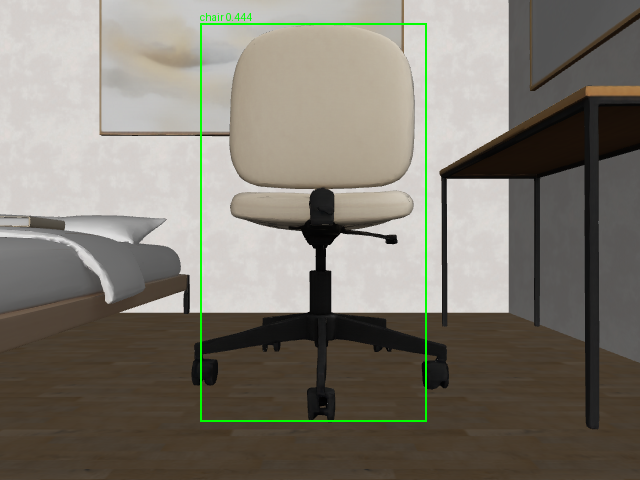
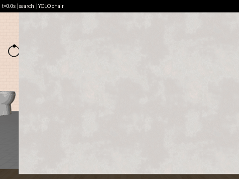
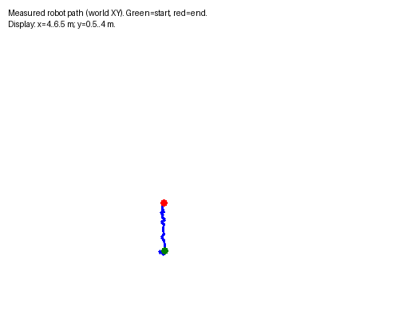
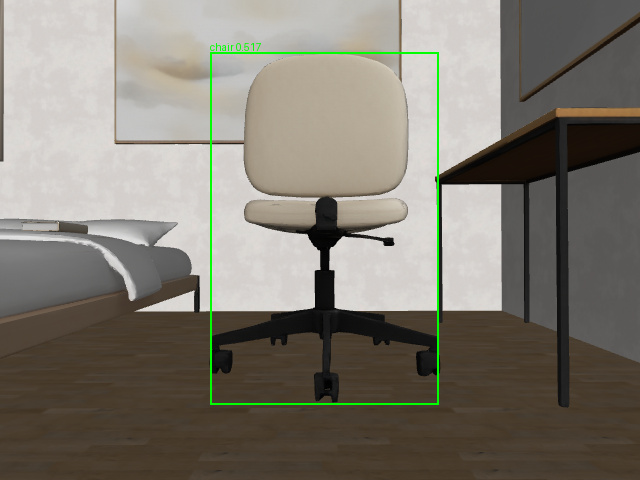

# Phase 2A visual evidence — newly executed Tyler trials

These outputs belong to the individual object-search pilot, not Connor's forensic experiments.

## Detector gate

The [first probe failed](probe_001/gate.json); it remains available for inspection. After correcting preprocessing and configuring the camera/placement, the [second stationary probe](probe_002/gate.json) detected a chair with confidence 0.444 at the unchanged 0.30 threshold.

The [final-config probe](probe_003_current_config/gate.json) also passed at mission-start XY with an aligned heading, at confidence **0.683**. This checks the delivered README/configuration without replacing the earlier gate or reusing it as another task-success trial.

## Detector-driven search and approach

[Raw trial and outcome](../data/sample/demo_001/summary.json). The camera initially looks away. The task scans, confirms consecutive observations, approaches using measured depth and captures the inspection after stopping.

## Final inspection

[Inspection observation and timestamp](../data/sample/demo_001/inspection/observation.json): estimated surface range 1.049 m, confidence 0.517, measured horizontal speed 0.000435 m/s. Camera range is not a ground-truth object-centre distance.

## Failure evidence and reproduction

The [timeout trial](../data/sample/timeout_001/summary.json) deliberately fails with `task_timeout` and a final zero command. [Successful-trial replay](../report/demo_001_replay.json) verified all recorded files, synchronized timestamps, repeated actual YOLO predictions and task decisions; [failure replay](../report/timeout_001_replay.json) reproduced the failure decision. No success-rate claim is inferred from this single successful pilot.

The original timeout ended one control tick late due to floating-point rounding. The [corrected timeout](../data/sample/timeout_002/summary.json) ended at 1.0 simulated second; [its replay](../report/timeout_002_replay.json) verified the corrected failure/stop path. Both raw trials remain intact.
